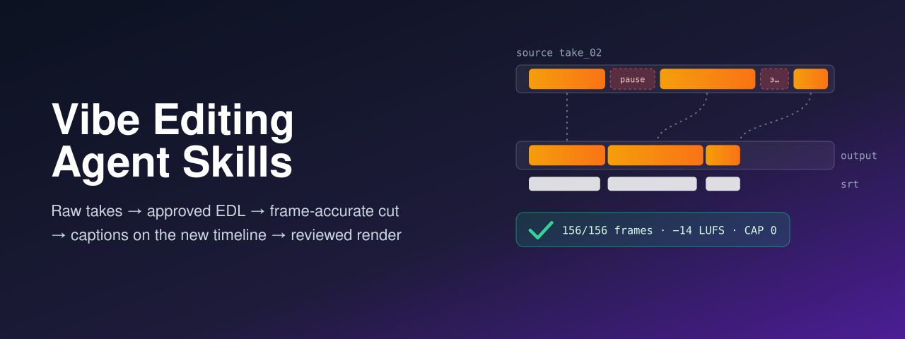
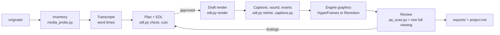

<p align="center">
  
</p>

# Vibe Editing Agent Skills

[](https://github.com/alexey1312/Vibe-Editing-Agent-Skill/actions/workflows/validate.yml)
[](LICENSE)

**Agent Skills for editing video by talking to an AI coding agent.**
They help an agent turn raw takes into a cut that keeps the meaning,
render it frame by frame exactly as approved,
move captions and graphics onto the new timeline,
and review the result with evidence before anyone publishes it.
The skills work in any AI coding tool that supports the
[Agent Skills open format](https://agentskills.io/home).

"Vibe editing" is editing through conversation:
the author gives the intent and the notes,
the agent changes the project, runs the tools and shows the next version.
It works when every decision is written down and checkable.
These skills make the agent write the cut as an edit decision list (EDL) with a reason per clip,
wait for approval, keep source time and output time apart,
and say what it checked and what it did not.

**Website:** <https://blog.kakoulin.com/apps/vibe-editing-agent-skills>

## Works alongside HyperFrames and Remotion

[HyperFrames](https://github.com/heygen-com/hyperframes) and
[Remotion](https://www.remotion.dev/docs/ai/coding-agents) ship their own agent skills
for building compositions: titles, overlays, animated explainers, product videos.
Install those too.
These skills cover what happens around them:

- **The cut** — choosing takes, removing pauses and false starts, clips from long recordings,
  an EDL the author approves, and a frame-accurate FFmpeg render of it.
- **The timeline maths** — every caption, insert and review note moved from source time to output time,
  and handed to HyperFrames (`edl.py hyperframes`) or Remotion (`edl.py remotion`).
- **The review** — the rendered file against the brief, the EDL and the captions,
  plus the checks no script can do.

Captions or overlays on footage that must not change stay with HyperFrames'
`embedded-captions` and `talking-head-recut`; the skills route them there by name.

## The flow



## What is measured, and what is not

`scripts/probes/ffmpeg_probes.py` makes synthetic media and re-measures every behaviour the skills rely on;
CI runs it on every push and once a week
([`measured-behavior.md`](references/measured-behavior.md)).
On FFmpeg 9.0.2 (2026-10-15) it found, among other things:

- `edl.py render` keeps exactly the planned frames — 156 of 156 —
  and the audio lands where `edl.py map` says, within 0.1 ms;
- a cut with `-ss` and `-c copy` starts at the previous keyframe:
  a decoder that ignores the MP4 edit list shows a second that was cut;
- a join without fades makes a sample step 14 times steeper than the tone itself; 10 ms fades remove it;
- the concat demuxer joins clips of different sizes without an error, and labels the result with the first clip's size;
- the default Homebrew FFmpeg has no `subtitles` filter, so it cannot burn captions.

**Not measured here:** how a recogniser handles your language, how the HyperFrames and Remotion snippets render,
loudness normalisation, and anything about meaning, rhythm or taste.
Those claims are cited — to FFmpeg's documentation, Netflix and BBC subtitle guidelines, EBU R 128,
and the tools' own repositories — or left to the person who watches the video.

## The skills

| Skill | Use it for |
| --- | --- |
| [`vibe-editing-cut`](skills/vibe-editing-cut/SKILL.md) | Raw takes, interviews, podcasts, tutorials and screen recordings into a cut: inventory, transcripts, the EDL, the draft render, captions, sound and inserts on the new timeline, other formats |
| [`vibe-editing-review`](skills/vibe-editing-review/SKILL.md) | A rendered video against the brief, the EDL and the captions: black, frozen and silent stretches, loudness, caption limits, a full viewing; diagnosing a broken render; the handoff; turning a format into a series |

## Plan before cut

1. **Report the machine.**
   `toolchain_report.py` says whether it can render frame-accurately, burn captions, measure loudness,
   recognise speech locally, and run HyperFrames or Remotion — and which key names are set, never their values.
2. **Inventory.**
   `media_probe.py` finds variable frame rates, rotation, HDR and mixed formats before they break a cut
   ([`CHECKS.md`](CHECKS.md)).
3. **Plan.**
   Every item has an ID (`CUT-03`), source and output times, a reason, evidence and a way to verify it;
   the EDL is the sum of the approved items.
4. **Apply** only approved items, one level at a time — story, pace, text, picture, sound —
   then review with `qa_scan.py` and one full viewing with sound.

Uploading media, cloud transcription and installs are changes too, and wait for approval.

## How to Use These Skills

### Option A: Using skills.sh

```bash
npx skills add https://github.com/alexey1312/Vibe-Editing-Agent-Skill
```

Then, in your agent:

> Use the vibe editing cut skill to plan a 40-second video from the takes in `originals/`.

### Option B: Claude Code Plugin

#### Personal Usage

1. Add the marketplaces — this one and HyperFrames':

```bash
/plugin marketplace add alexey1312/Vibe-Editing-Agent-Skill
/plugin marketplace add heygen-com/hyperframes
```

2. Install the plugins:

```bash
/plugin install vibe-editing-skills@vibe-editing-skills
/plugin install hyperframes@hyperframes
```

For Remotion, run `npx remotion skills add` inside a Remotion project.

#### Project Configuration

To provide the skills to everyone working in a repository,
configure the repository's `.claude/settings.json`:

```json
{
  "enabledPlugins": {
    "vibe-editing-skills@vibe-editing-skills": true,
    "hyperframes@hyperframes": true
  },
  "extraKnownMarketplaces": {
    "vibe-editing-skills": {
      "source": {
        "source": "github",
        "repo": "alexey1312/Vibe-Editing-Agent-Skill"
      }
    },
    "hyperframes": {
      "source": {
        "source": "github",
        "repo": "heygen-com/hyperframes"
      }
    }
  }
}
```

### Option C: Codex / OpenAI-compatible tools

This repository includes an `agents/openai.yaml` manifest.
Copy or symlink the skill folders into your Codex skills directory:

```bash
cp -R skills/vibe-editing-* "$CODEX_HOME/skills/"
```

### Option D: Using pi package manager

```bash
pi install https://github.com/alexey1312/Vibe-Editing-Agent-Skill
```

### Option E: Manual install

1. **Clone** this repository.
2. **Install or symlink** the folders under `skills/` following your tool's skills docs.
3. **Ask your AI tool** to use the `vibe-editing-cut` or `vibe-editing-review` skill on your project.

Or download a single `.skill` archive from the
[latest release](https://github.com/alexey1312/Vibe-Editing-Agent-Skill/releases/latest).

#### Where to Save Skills

- **Codex:** [Where to save skills](https://developers.openai.com/codex/skills/#where-to-save-skills)
- **Claude:** [Using Skills](https://docs.claude.com/en/docs/agents-and-tools/agent-skills/overview)
- **Cursor:** [Enabling Skills](https://cursor.com/docs/context/skills#enabling-skills)

**How to verify:**
your agent should run the toolchain report and the media inventory first,
present a plan with item IDs, source and output times,
say what it cannot verify on your machine,
and wait for you to approve items before it renders, uploads or installs anything.

## Requirements

FFmpeg and ffprobe on `PATH`, and Python 3.9 or later; the scripts use only the standard library.
HyperFrames and Remotion need Node.js ([`versions.md`](references/versions.md)).

## Skill Structure

```text
skills/
├── vibe-editing-cut/
│   ├── SKILL.md
│   ├── references/   routes, EDL format, transcripts, cutting, inserts and layouts, screen recordings + shared files
│   ├── scripts/      toolchain_report, media_probe, edl, captions, qa_scan
│   └── evals/        evals.json, trigger-evals.json, text fixtures, media generators (not shipped)
└── vibe-editing-review/
    ├── SKILL.md
    ├── references/   acceptance checklist, troubleshooting, series + shared files
    ├── scripts/      the same five scripts
    └── evals/
references/           canonical shared files: captions, sound, data and licences, project memory, plan format, sources, versions, measurements
scripts/              the five scripts, FFmpeg probes, eval staging, packaging, copy sync
```

## Benchmark

Nine cases, three runs each, with and without the skills
([`benchmarks/2026-10-15`](benchmarks/2026-10-15/README.md)):

| | Without the skills | With the skills |
| --- | --- | --- |
| Mean score | 0.837 | **0.976** |
| Runs passing every criterion | 10 of 27 | **23 of 27** |

The gains are where the base model lacks knowledge or process:
YouTube publishes no loudness target, a scan cannot judge meaning or rhythm,
audio sent for recognition leaves the machine, variable frame rate and rotation hide in the files,
and a result is checked before it is reported.
Three cases score 1.00 without the skills as well.
The write-up lists every failure with the skills — a fixture defect, a judge error, a strict criterion — before you cite a number.

## This skill's approach

- **Grounded:** every rule cites FFmpeg's documentation, a published norm (Netflix, BBC, EBU, Apple, Spotify),
  a tool's repository pinned to a commit, or a probe — or says *inference*.
- **Measured where it can be:** the probes re-run on every push; nothing about a recogniser or an engine is called measured.
- **Dated:** versions, licences, prices and star counts live in one file with the date they were checked.
- **Next to the engines, not instead of them:** HyperFrames and Remotion skills own composition code.
- **Safe by design:** read-only first, approval by item ID, originals never written, keys never printed.

## Sources

Every source, with its licence and the revision read, is in
[`references/sources.md`](references/sources.md).
The work started from the Russian guide *Вайб-монтаж с AI-агентами* (Telegram channel «Точки над ИИ», 2026-10-15);
it is listed as background reading, nothing is copied from it,
and every claim taken from it was checked against the primary sources.

## Contributing

See [`CONTRIBUTING.md`](CONTRIBUTING.md) and [`AGENTS.md`](AGENTS.md).
Re-checked versions and new FFmpeg probes are the most useful contributions.

## About the author

Made by Aleksei Kakoulin on the model of
[iPhone Duo Agent Skills](https://github.com/alexey1312/iPhone-Duo-Agent-Skill),
[Swift Charts Agent Skills](https://github.com/alexey1312/Swift-Charts-Agent-Skill) and
[Swift Android Agent Skills](https://github.com/alexey1312/Swift-Android-Agent-Skill).
Not affiliated with HeyGen, Remotion, Browser Use, the FFmpeg project or «Точки над ИИ».

## License

[MIT](LICENSE).
